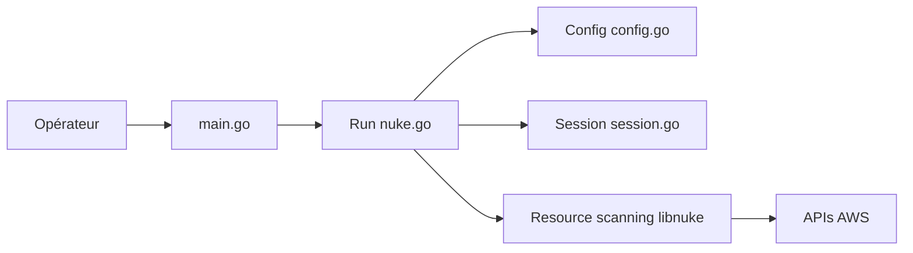

# ekristen/aws-nuke

> Go CLI that deletes all the resources of an AWS account, to clean up test accounts.

## The problem
Sandbox AWS accounts accumulate forgotten resources that cost money and take a long time to delete by hand.

## What it actually does
Loads a config and credentials, identifies the account and regions, scans the registered resource types, then deletes whatever the filters do not exclude, after confirmation or in dry-run. A rewritten fork of rebuy-de/aws-nuke built around the libnuke library. Commands to explain an account/config and to list resources. AWS coverage is incomplete, by the README's own admission.

## How it is wired


## Trying it
```bash
brew install ekristen/tap/aws-nuke@3
```
The README points to the online documentation for the config; the `run` subcommand (alias `nuke`) replaces the old root command.

## Cost and gotchas
Free, but destructive: a bad config or the wrong account wipes everything. Resources not covered remain. 135 open issues.

## What it is not
Not a continuous governance tool: it deletes, it does not protect. Not yet on Go SDK v2.

## Alternatives
rebuy-de/aws-nuke, the original project this one forks, updated more slowly according to the author.

## For you
Adopt for ML sandbox accounts: it avoids forgotten bills (GPUs, volumes); use it with filters and dry-run.
