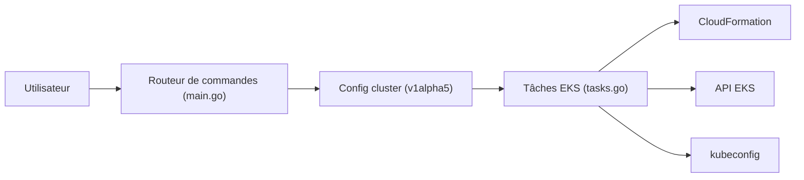

# eksctl-io/eksctl

> Official CLI to create and manage Amazon EKS clusters, for infrastructure teams on AWS.

## The problem
Setting up an EKS cluster by hand (VPC, IAM roles, node groups) is slow and error-prone.

## What it actually does
`eksctl create cluster` produces a cluster in a few minutes via CloudFormation, with defaults (2 m5.large nodes, us-west-2 region, dedicated VPC, official EKS AMI) and writes the access details to `~/.kube/config`. It also handles node groups, addons, Auto mode, access entries, pod identity and a VPC controller. Written in Go.

## How it is wired


## Trying it
```bash
curl -sLO "https://github.com/eksctl-io/eksctl/releases/latest/download/eksctl_$PLATFORM.tar.gz"
docker run --rm -it public.ecr.aws/eksctl/eksctl version
eksctl create cluster
```

## Cost and gotchas
AWS credentials and extensive IAM permissions are required; the resources created (EC2, EKS, VPC) are billed by AWS. Watch the VPC quotas. A license is present but not identified by GitHub.

## What it is not
Not a multi-cloud tool, and not an application deployment manager: it provisions the cluster. Third-party installers (Homebrew, Chocolatey…) are not supported by AWS.

## Alternatives
Not documented in the README: no alternative named (Terraform is mentioned as another tool that reads the credentials).

## For you
Adopt if your MLOps workloads run on EKS: it is the most direct route to a test cluster; check the license, and the AWS cost of a cluster left running.
