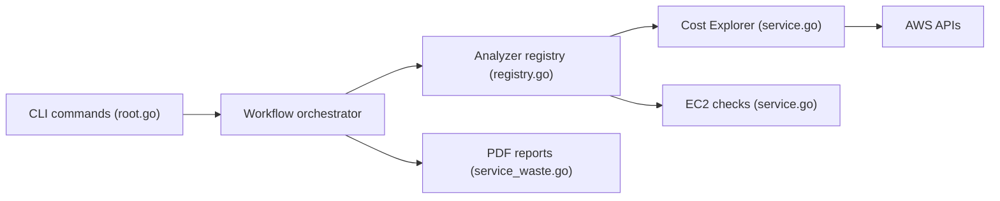

# elC0mpa/aws-doctor

> Command-line tool that checks the health of an AWS account: costs, trends, unused resources.

## The problem
The AWS console shows the raw bill without saying whether you are spending efficiently or what to clean up.

## What it actually does
Compares months over identical windows, plots a six-month trend, and spots waste (elastic IPs, stopped or idle instances, orphaned snapshots, RDS, NAT, load balancers, oversized Lambdas, SageMaker endpoints, ECR, secrets, IAM). Output as table, JSON, CSV or PDF report.

## How it is wired


## Trying it
```bash
brew install elC0mpa/homebrew-tap/aws-doctor
go install github.com/elC0mpa/aws-doctor@latest
aws-doctor waste ec2 s3 lambda
aws-doctor report cost
aws-doctor report waste --path ./billing-analysis.pdf
```

## Cost and gotchas
AWS credentials with read permissions (Cost Explorer, `pricing:GetProducts` for regional prices, otherwise defaults). Cost Explorer calls may be billed by AWS; the README gives no figure.

## What it is not
Not a full replacement for Trusted Advisor; it diagnoses, it does not fix. Double-check the cost estimates.

## Alternatives
AWS Trusted Advisor (paid), cited as what it replaces for free.

## For you
Adopt: an MLOps profile paying for GPUs and SageMaker will quickly find forgotten resources, with no licence cost.
