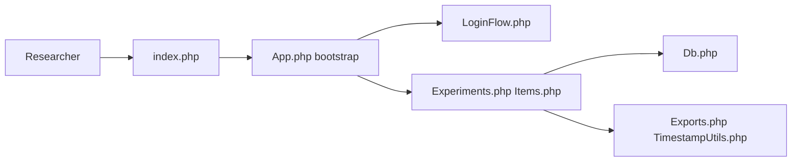

# elabftw/elabftw

> Self-hosted electronic lab notebook for research teams: experiments, resources, timestamping.

## The problem
Research teams must trace experiments and materials in a reproducible and secure way, without sending their data to a third party.

## What it actually does
Multi-team web application: experiment notebook, resource database (reagents, cell lines, products), trusted timestamping and blockchain, import/export, booking calendar, molecule editor, LaTeX, public REST API, 21 languages, fine-grained permissions. Installs via Docker (512 MB of RAM minimum, 1 GB recommended).

## How it is wired


## Trying it
```bash
# Aucune commande dans le README : voir les instructions d'installation Docker de la documentation.
```

## Cost and gotchas
Free; dedicated hosting is paid with the vendor. The name and logo are a registered trademark of Deltablot SASU.

## What it is not
Not a data analysis tool. AGPL-3.0, and use of the trademark is governed by TRADEMARK.md.

## Alternatives
RSpace and LabFolder are cited as import sources, not as recommended alternatives.

## For you
Ignore unless you are in a lab context: a good lab notebook, but with no direct link to data/AI/MLOps (the README mentions two unofficial MCP servers).
