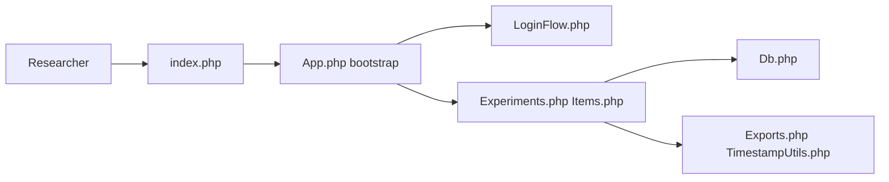

# elabftw/elabftw

> Cahier de laboratoire électronique auto-hébergé pour équipes de recherche : expériences, ressources, horodatage.

## Le problème
Les équipes de recherche doivent tracer expériences et matériel de façon reproductible et sécurisée, sans envoyer leurs données à un tiers.

## Ce que ça fait vraiment
Application web multi-équipes : carnet d'expériences, base de ressources (réactifs, lignées, produits), horodatage de confiance et blockchain, import/export, calendrier de réservation, éditeur de molécules, LaTeX, API REST publique, 21 langues, permissions fines. S'installe via Docker (512 Mo de RAM minimum, 1 Go conseillé).

## Comment c'est branché


## Essayer
```bash
# Aucune commande dans le README : voir les instructions d'installation Docker de la documentation.
```

## Coût et pièges
Gratuit ; l'hébergement dédié est payant chez l'éditeur. Le nom et le logo sont une marque déposée de Deltablot SASU.

## Ce que ce n'est pas
Pas un outil d'analyse de données. AGPL-3.0, et l'usage de la marque est encadré par TRADEMARK.md.

## Alternatives
RSpace et LabFolder sont cités comme sources d'import, non comme alternatives recommandées.

## Pour toi
À ignorer sauf contexte de laboratoire : bon cahier de labo, mais sans lien direct avec la data/IA/MLOps (le README cite deux serveurs MCP non officiels).

