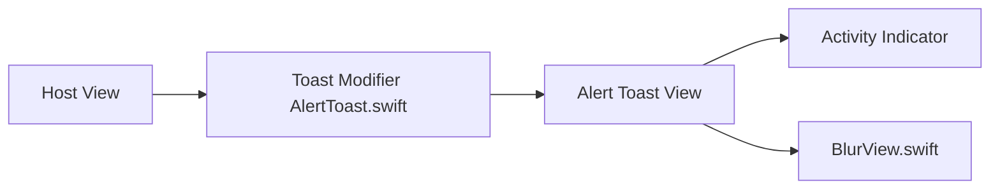

# elai950/AlertToast

> SwiftUI library for showing alerts and toasts that need no user action.

## The problem
SwiftUI only offers `Alert`: the user has to tap OK for every piece of information.

## What it actually does
A `.toast` modifier shows ephemeral windows in three modes (alert in the center, HUD from the top, banner from the bottom), with text, success, error, system image, image and loading types. Light/dark mode, localization, font and background customization. iOS 13+ and macOS 11+.

## How it is wired


## Trying it
```ruby
pod 'AlertToast'
```
```swift
.toast(isPresenting: $showToast){
    AlertToast(type: .regular, title: "Message Sent!")
}
```

## Cost and gotchas
Free. Last push in November 2024. The README shows an ambiguous cryptocurrency donation address (BNB network, labeled BTC): be careful.

## What it is not
Not cross-platform outside Apple. Not system notifications.

## Alternatives
No alternative named in the README.

## For you
Ignore: an iOS/macOS UI library unrelated to data, AI or MLOps, and not very active since late 2024.
