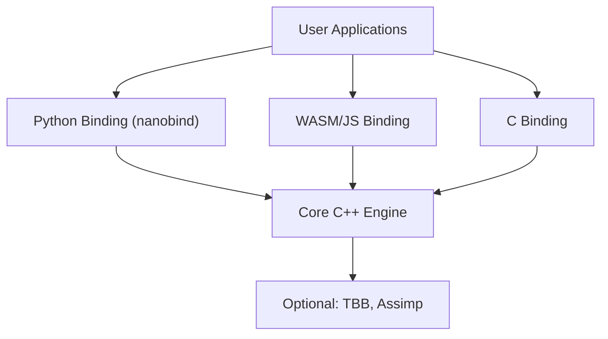

# elalish/manifold

> C++ geometry library that guarantees manifold 3D meshes, with Python and JavaScript bindings.

## The problem
Boolean operations on 3D meshes often produce invalid solids, unusable in manufacturing or CAD.

## What it actually does
Manifold provides boolean operations on triangle meshes with guaranteed manifold output, arbitrary vertex properties, smoothing functions and signed distance field evaluation. Parallelism goes through optional TBB; the WASM build is sequential. Bindings exist for C, Python (manifold3d), JS/TS (manifold-3d) and other languages. OpenSCAD, Blender and Godot are cited as users.

## How it is wired


## Trying it
```bash
git clone --recurse-submodules https://github.com/elalish/manifold.git
cd manifold
mkdir build
cd build
cmake -DCMAKE_BUILD_TYPE=Release -DBUILD_SHARED_LIBS=ON .. && make
make test
```

## Cost and gotchas
Free. You need CMake, a C++ compiler and Python; TBB is recommended for speed. Inputs must be manifold, otherwise an error is returned. The README discourages the STL format in favor of 3MF or glTF.

## What it is not
It is not a CAD application: it is a geometry kernel. ManifoldCAD.org is a separate sandbox.

## Alternatives
- OpenSCAD: script-based modeler; Manifold is integrated into it to make it faster.
- trimesh: mesh manipulation in Python, with a binding to manifold3d.

## For you
Worth watching: interesting only if your pipeline handles 3D meshes (simulation, printing); otherwise no link to data or AI.
