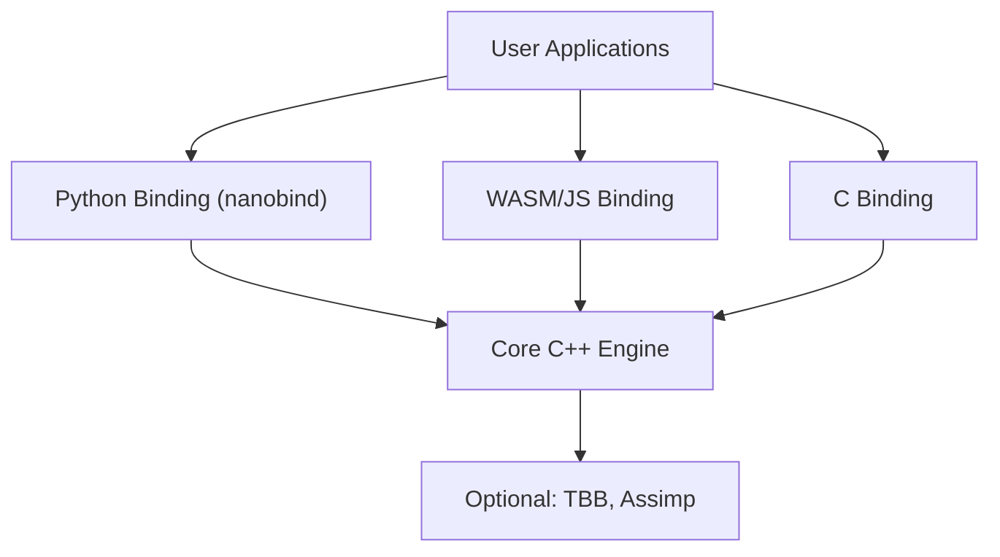

# elalish/manifold

> Bibliothèque C++ de géométrie qui garantit des maillages 3D manifold, avec liaisons Python et JavaScript.

## Le problème
Les opérations booléennes sur maillages 3D produisent souvent des solides invalides, inutilisables en fabrication ou en CAO.

## Ce que ça fait vraiment
Manifold fournit des opérations booléennes sur maillages triangulaires avec sortie garantie manifold, des propriétés de sommets arbitraires, des fonctions de lissage et une évaluation de champs de distance signée. Le parallélisme passe par TBB en option ; le build WASM est séquentiel. Des liaisons existent pour C, Python (manifold3d), JS/TS (manifold-3d) et d'autres langages. OpenSCAD, Blender et Godot sont cités comme utilisateurs.

## Comment c'est branché


## Essayer
```bash
git clone --recurse-submodules https://github.com/elalish/manifold.git
cd manifold
mkdir build
cd build
cmake -DCMAKE_BUILD_TYPE=Release -DBUILD_SHARED_LIBS=ON .. && make
make test
```

## Coût et pièges
Gratuit. Il faut CMake, un compilateur C++ et Python ; TBB est conseillé pour la vitesse. Les entrées doivent être manifold, sinon une erreur est renvoyée. Le README déconseille le format STL au profit de 3MF ou glTF.

## Ce que ce n'est pas
Ce n'est pas une application de CAO : c'est un noyau géométrique. ManifoldCAD.org est un bac à sable à part.

## Alternatives
- OpenSCAD : modeleur par script ; Manifold y est intégré pour aller plus vite.
- trimesh : manipulation de maillages en Python, avec liaison à manifold3d.

## Pour toi
À surveiller : intéressant seulement si ton pipeline traite des maillages 3D (simulation, impression) ; sinon pas de lien avec la data ou l'IA.

