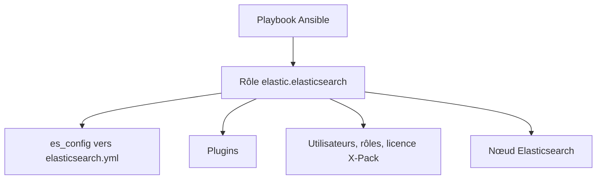

# elastic/ansible-elasticsearch

> Ansible role to install and configure Elasticsearch 6.x and 7.x on Linux servers.

## The problem
Installing Elasticsearch by hand on several servers, with its plugins, security and configuration, is slow and hard to reproduce.

## What it actually does
- Installs one Elasticsearch node per host and configures it through an `es_config` table written into `elasticsearch.yml`.
- Manages plugins, users, roles, X-Pack license, keystore and proxy.
- Targets Ubuntu, Debian, CentOS and Amazon Linux 2.
- Can replace the provided configuration files with your own templates.

## How it is wired
Simplified diagram based on the sheet, no diagram provided.


## Trying it
```bash
ansible-galaxy install elastic.elasticsearch,v7.17.0
ansible-playbook -i hosts ./your-playbook.yml
```

## Cost and gotchas
Plan for Ansible and the jmespath library locally. Tests require Ruby, Bundler, Docker and Make (Ruby is not in the prerequisites list). X-Pack is paid beyond the 30-day trial.

## What it is not
Not maintained: the README says the role targets 6.x and 7.x and "should" work with 8.x, with no guarantee.

## Alternatives
- Elastic Cloud (hosted service), Elastic Cloud on Kubernetes, Docker guide and Terraform provider, all cited in the README.

## For you
Ignore: archived role for old versions; go with Elastic Cloud on Kubernetes or Docker instead.
