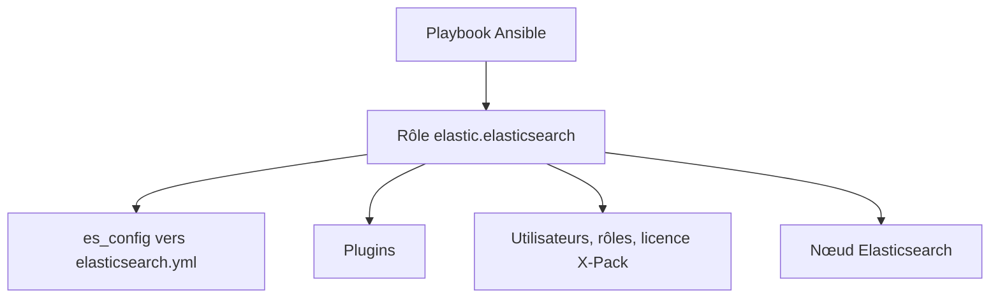

# elastic/ansible-elasticsearch

> Rôle Ansible pour installer et configurer Elasticsearch 6.x et 7.x sur des serveurs Linux.

## Le problème
Installer Elasticsearch à la main sur plusieurs serveurs, avec ses plugins, sa sécurité et sa configuration, est long et peu reproductible.

## Ce que ça fait vraiment
- Installe un nœud Elasticsearch par hôte et le configure via une table `es_config` écrite dans `elasticsearch.yml`.
- Gère plugins, utilisateurs, rôles, licence X-Pack, keystore et proxy.
- Cible Ubuntu, Debian, CentOS et Amazon Linux 2.
- Peut remplacer les fichiers de configuration fournis par des gabarits personnels.

## Comment c'est branché
Schéma simplifié d'après la fiche, sans diagramme fourni.


## Essayer
```bash
ansible-galaxy install elastic.elasticsearch,v7.17.0
ansible-playbook -i hosts ./your-playbook.yml
```

## Coût et pièges
Prévoir Ansible et la bibliothèque jmespath en local. Les tests exigent Ruby, Bundler, Docker et Make (Ruby n'est pas dans la liste des prérequis). X-Pack payant au-delà de l'essai de 30 jours.

## Ce que ce n'est pas
Pas maintenu : le README dit que le rôle vise 6.x et 7.x et « devrait » fonctionner avec 8.x, sans garantie.

## Alternatives
- Elastic Cloud (service hébergé), Elastic Cloud on Kubernetes, guide Docker et fournisseur Terraform, tous cités dans le README.

## Pour toi
À ignorer : rôle archivé pour des versions anciennes ; pars plutôt sur Elastic Cloud on Kubernetes ou Docker.

