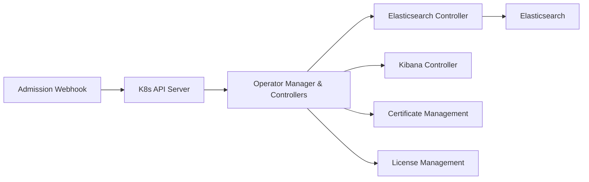

# elastic/cloud-on-k8s

> Kubernetes operator that deploys and manages the Elastic stack (Elasticsearch, Kibana, Beats, Logstash…).

## The problem
Running an Elasticsearch cluster on Kubernetes by hand: certificates, topology changes, volumes, lossless upgrades.

## What it actually does
An operator (controller/reconcile model) watches CRDs and creates the Kubernetes resources for Elasticsearch, Kibana, APM Server, Enterprise Search, Beats, Elastic Agent, Maps Server, Logstash. It handles TLS certificates, safe configuration changes, persistent volumes, the secrets keystore. Supported versions: Kubernetes 1.32–1.36, OpenShift 4.16–4.22.

## How it is wired

## Trying it
The README points to the Quickstart in the documentation; no commands appear there.

## Cost and gotchas
You need a Kubernetes cluster. The GitHub license is not identified; Elastic license management is a separate module: check what is paid.

## What it is not
It is not Elasticsearch itself nor a managed service: it is the automation around it. 496 open issues.

## Alternatives
No alternative named in the README.

## For you
Worth watching: useful if you run Elasticsearch (search, RAG) on Kubernetes; otherwise off-topic.
