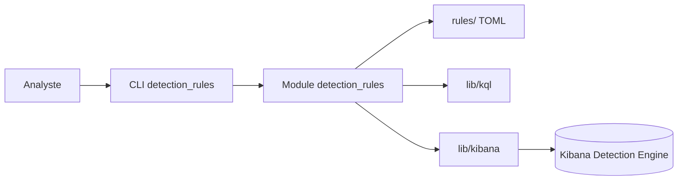

# elastic/detection-rules

> Elastic Security detection rules and Python tools to write, validate and publish them.

## The problem
Maintaining detection rules by hand, without tests or schema validation, produces wrong or inconsistent rules.

## What it actually does
The repository contains the rules in TOML format (`rules/`, `rules_building_block/`), threat hunting queries (`hunting/`), a Python module `detection_rules` (parsing, validation, packaging, CLI) and two libraries `kibana` and `kql`. The CLI creates, tests, imports and exports rules and talks to Kibana and Elasticsearch, following a "detections as code" approach. Attack automations (RTA) are in a separate repository, Cortado.

## How it is wired


## Trying it
```bash
make
pip3 install ".[dev]"
python -m detection_rules --help
pip3 install lib/kibana lib/kql
```

## Cost and gotchas
Python 3.12+. `kibana` and `kql` are not on PyPI. The rules are mainly used with Elastic Security; contributing requires a contributor licence agreement (CLA).

## What it is not
The whole repository is under Elastic License v2, a licence not recognised as classic open source: it is intended for use within Elastic's Detection Engine. It is not a SIEM.

## Alternatives
No alternative named in the README.

## For you
Worth watching: a good example of tested "detection as code", but the ELv2 licence limits use outside Elastic.
