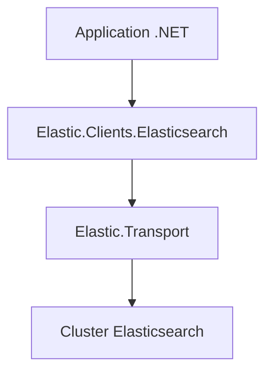

# elastic/elasticsearch-net

> Official .NET client for Elasticsearch, with strongly typed requests and responses, for C# developers.

## The problem
Calling the Elasticsearch REST API by hand from .NET is tedious and prone to typing errors.

## What it actually does
Provides `Elastic.Clients.Elasticsearch`, with typed requests and responses for the Elasticsearch APIs. Transport (HTTP connections, pool, retries) is delegated to the Elastic.Transport library. Major and minor versions follow those of the server. Documented uses: create an index, index, search, update, delete.

## How it is wired
Simplified diagram based on the sheet, no diagram provided.



## Trying it
```bash
curl -fsSL https://elastic.co/start-local | sh
```
This command starts Elasticsearch (port 9200) and Kibana (port 5601) locally; installing the client is deferred to the documentation.

## Cost and gotchas
Free on the client side. An Elasticsearch cluster is required. Versioning does not strictly follow semver: a minor or patch version may contain breaking changes.

## What it is not
Not an Elasticsearch server nor a search tool: only a .NET client. Compatibility does not imply feature parity between versions.

## Alternatives
- No alternative named in the README.

## For you
Ignore unless you are on a .NET stack: a serious official client, but your data and AI work will rather go through the Python clients.
