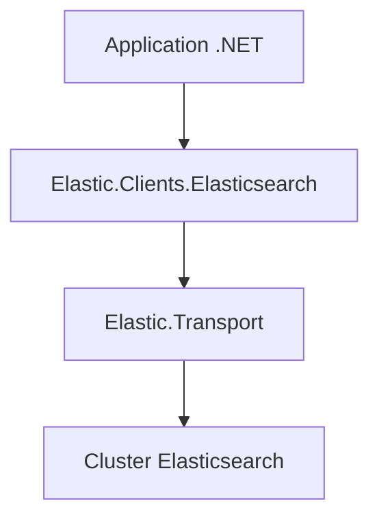

# elastic/elasticsearch-net

> Client .NET officiel d'Elasticsearch, avec requêtes et réponses fortement typées, pour développeurs C#.

## Le problème
Appeler l'API REST d'Elasticsearch à la main depuis .NET est fastidieux et sujet aux erreurs de typage.

## Ce que ça fait vraiment
Fournit `Elastic.Clients.Elasticsearch`, avec requêtes et réponses typées pour les API Elasticsearch. Le transport (connexions HTTP, pool, nouvelles tentatives) est délégué à la bibliothèque Elastic.Transport. Les versions majeure et mineure suivent celles du serveur. Usages documentés : créer un index, indexer, chercher, mettre à jour, supprimer.

## Comment c'est branché
Schéma simplifié d'après la fiche, sans diagramme fourni.



## Essayer
```bash
curl -fsSL https://elastic.co/start-local | sh
```
Cette commande lance Elasticsearch (port 9200) et Kibana (port 5601) en local ; l'installation du client est renvoyée à la documentation.

## Coût et pièges
Gratuit côté client. Il faut un cluster Elasticsearch. Le versionnage ne suit pas strictement semver : une version mineure ou corrective peut contenir des changements cassants.

## Ce que ce n'est pas
Pas un serveur Elasticsearch ni un outil de recherche : seulement un client .NET. La compatibilité n'implique pas la parité de fonctions entre versions.

## Alternatives
- Aucune alternative nommée dans le README.

## Pour toi
À ignorer sauf pile .NET : un client officiel et sérieux, mais ton travail data et IA passera plutôt par les clients Python.

