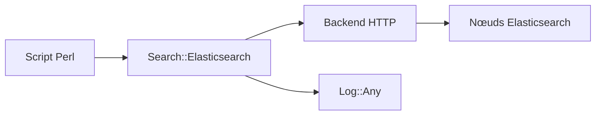

# elastic/elasticsearch-perl

> Official Perl client for Elasticsearch, for anyone maintaining Perl code.

## The problem
Calling the Elasticsearch REST API from Perl by hand means handling load balancing, failures and pagination yourself.

## What it actually does
`Search::Elasticsearch` covers all the APIs, handles multiple nodes with failover, offers helpers for bulk indexing, scrolling and reindexing, and connects to Elastic Cloud with an API key. An asynchronous variant exists.

## How it is wired
Simplified diagram based on the fiche, no diagram provided.



## Trying it
```bash
cpanm Search::Elasticsearch
```
```perl
my $e = Search::Elasticsearch->new(nodes => ['search:9200']);
my $result = $e->info();
```

## Cost and gotchas
Perl and an Elasticsearch server required. For Elastic Cloud, an API key to create in the console, with billing depending on the service. Last push in January 2025.

## What it is not
It is not a search engine: it is only a client. Nothing is guaranteed for older server versions.

## Alternatives
No alternative named in the README.

## For you
Ignore: unless you have existing Perl code, a Python or other client is more natural in data and AI.
