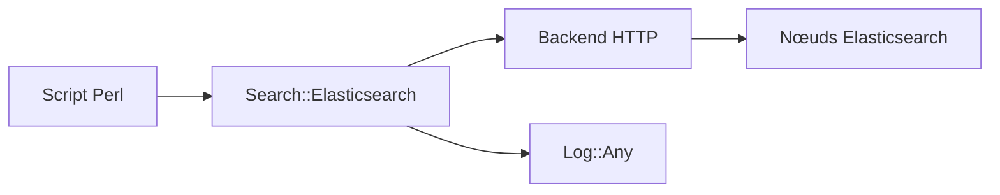

# elastic/elasticsearch-perl

> Client Perl officiel d'Elasticsearch, pour qui maintient du code Perl.

## Le problème
Appeler l'API REST d'Elasticsearch depuis Perl à la main oblige à gérer répartition de charge, échecs et pagination.

## Ce que ça fait vraiment
`Search::Elasticsearch` couvre toutes les API, gère les nœuds multiples avec bascule en cas de panne, propose des aides pour l'indexation en masse, le scroll et la réindexation, et se connecte à Elastic Cloud avec une clé d'API. Une variante asynchrone existe.

## Comment c'est branché
Schéma simplifié d'après la fiche, sans diagramme fourni.



## Essayer
```bash
cpanm Search::Elasticsearch
```
```perl
my $e = Search::Elasticsearch->new(nodes => ['search:9200']);
my $result = $e->info();
```

## Coût et pièges
Perl et un serveur Elasticsearch requis. Pour Elastic Cloud, une clé d'API à créer dans la console, dont la facturation dépend du service. Dernier push en janvier 2025.

## Ce que ce n'est pas
Ce n'est pas un moteur de recherche : c'est seulement un client. Rien n'est garanti pour les versions plus anciennes du serveur.

## Alternatives
Aucune alternative nommée dans le README.

## Pour toi
Ignorer : sauf code Perl existant, un client Python ou autre est plus naturel en data et IA.

