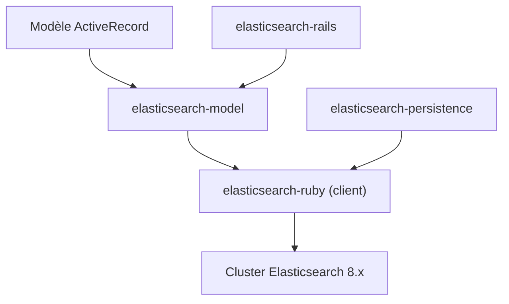

# elastic/elasticsearch-rails

> Ruby and Rails integrations for Elasticsearch: search on ActiveRecord models and a persistence layer.

## The problem
Connecting a Rails application to Elasticsearch requires a lot of glue and import code.

## What it actually does
Three gems: `elasticsearch-model` (`search`, `mapping`, `import` methods on ActiveRecord or Mongoid), `elasticsearch-persistence` (repository pattern for Ruby objects) and `elasticsearch-rails` (rake tasks, instrumentation, application templates). The client comes from elasticsearch-ruby. The main branch targets Elasticsearch 8.x.

## How it is wired
Simplified diagram based on the sheet, no diagram provided.



## Trying it
```bash
gem install elasticsearch-model
gem install elasticsearch-rails
rails new searchapp --skip --skip-bundle --template https://raw.github.com/elasticsearch/elasticsearch-rails/main/elasticsearch-rails/lib/rails/templates/01-basic.rb
```

## Cost and gotchas
Free, Ruby 3.0 or later, Elasticsearch cluster to be supplied. The test suite requires a cluster on port 9250 and deletes all its data. Last push more than a year ago.

## What it is not
Not a standalone Elasticsearch client, nor compatible with all versions: the gem number follows the Elasticsearch major version.

## Alternatives
Not documented in the README.

## For you
Ignore: only for Ruby on Rails applications, and activity is old.
