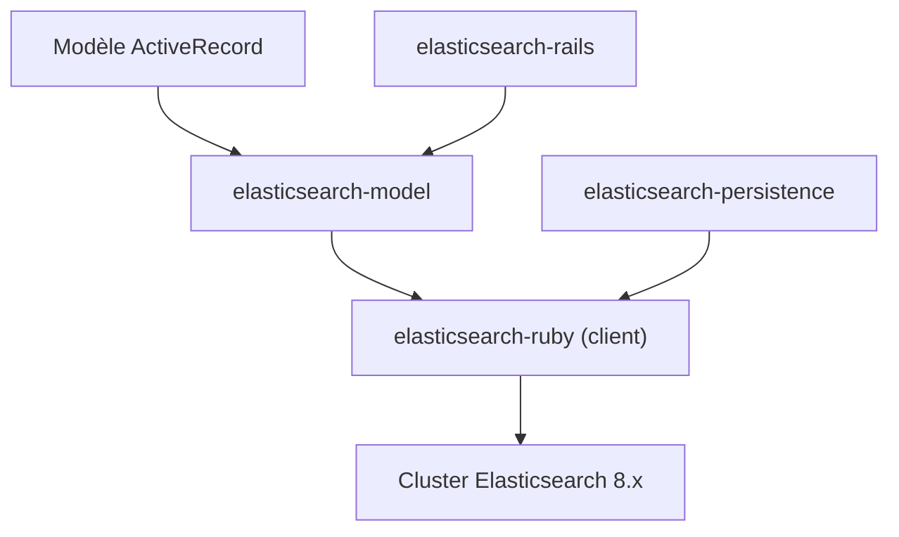

# elastic/elasticsearch-rails

> Intégrations Ruby et Rails pour Elasticsearch : recherche sur modèles ActiveRecord et couche de persistance.

## Le problème
Brancher une application Rails sur Elasticsearch demande beaucoup de code de liaison et d'import.

## Ce que ça fait vraiment
Trois gems : `elasticsearch-model` (méthodes `search`, `mapping`, `import` sur ActiveRecord ou Mongoid), `elasticsearch-persistence` (modèle repository pour objets Ruby) et `elasticsearch-rails` (tâches rake, instrumentation, modèles d'application). Le client vient d'elasticsearch-ruby. La branche main vise Elasticsearch 8.x.

## Comment c'est branché
Schéma simplifié d'après la fiche, sans diagramme fourni.



## Essayer
```bash
gem install elasticsearch-model
gem install elasticsearch-rails
rails new searchapp --skip --skip-bundle --template https://raw.github.com/elasticsearch/elasticsearch-rails/main/elasticsearch-rails/lib/rails/templates/01-basic.rb
```

## Coût et pièges
Gratuit, Ruby 3.0 ou plus, cluster Elasticsearch à fournir. La suite de tests exige un cluster sur le port 9250 et supprime toutes ses données. Dernier push il y a plus d'un an.

## Ce que ce n'est pas
Pas un client Elasticsearch seul, ni compatible avec toutes les versions : le numéro de gem suit la version majeure d'Elasticsearch.

## Alternatives
Non documenté dans le README.

## Pour toi
À ignorer : réservé aux applications Ruby on Rails, et l'activité est ancienne.

