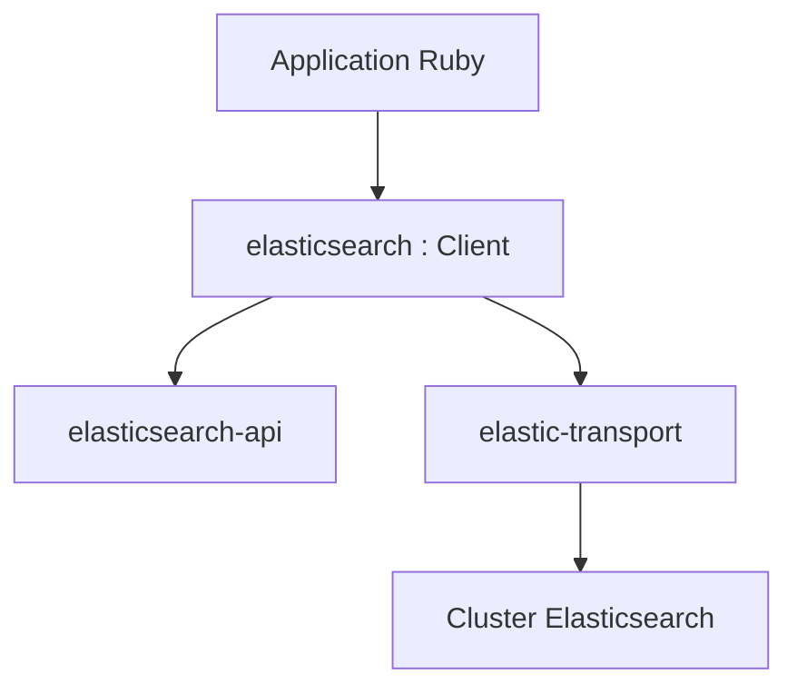

# elastic/elasticsearch-ruby

> Official Ruby client for Elasticsearch, for Ruby applications that query a cluster.

## The problem
Talking to Elasticsearch's REST API by hand from Ruby is verbose and fragile.

## What it actually does
The `elasticsearch` gem combines `elastic-transport` (low-level connection to the cluster) and `elasticsearch-api` (Ruby API over REST). It follows Elasticsearch versions 8.x and 9.x and Ruby's maintenance policy. Other official gems cover Rails and the query DSL.

## How it is wired
Simplified diagram based on the sheet, no diagram provided.


## Trying it
```bash
gem install elasticsearch
curl -fsSL https://elastic.co/start-local | sh
```
```ruby
require 'elasticsearch'
client = Elasticsearch::Client.new(host: 'https://my-elasticsearch-host.example')
client.ping
client.search(q: 'test')
```

## Cost and gotchas
Free, but you need an Elasticsearch cluster (local with Docker, or paid Elastic Cloud). For good performance, add an HTTP library with persistent connections such as Patron or Typhoeus.

## What it is not
Not an Elasticsearch server. The client is compatible with default distributions only, and a new server feature requires the matching client version.

## Alternatives
- elasticsearch-rails: integration with Rails models.
- elasticsearch-dsl: Ruby API for the Query DSL.

## For you
Adopt it if your stack is Ruby and Elasticsearch: official client, vendor-maintained, no surprises; otherwise irrelevant.
