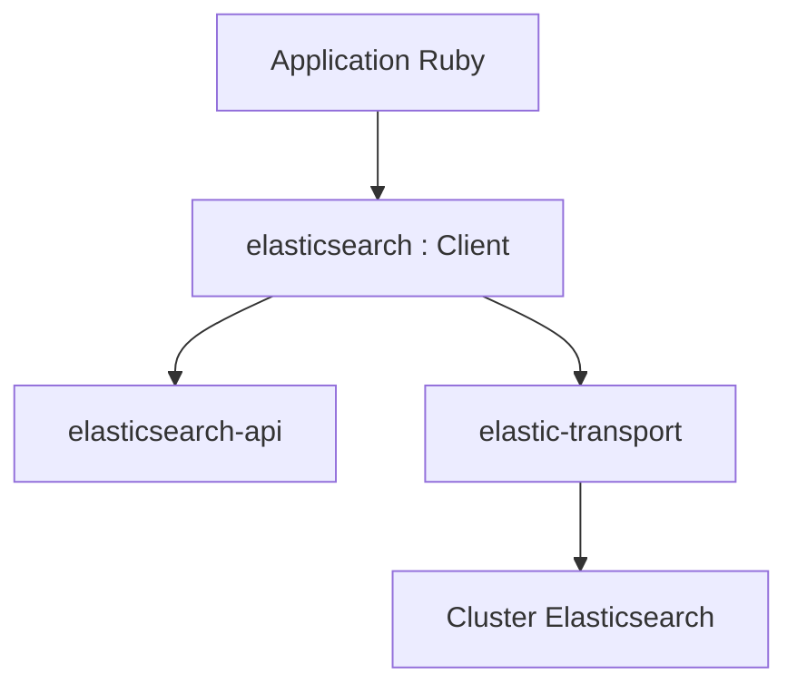

# elastic/elasticsearch-ruby

> Client Ruby officiel d'Elasticsearch, pour applications Ruby qui interrogent un cluster.

## Le problème
Parler à l'API REST d'Elasticsearch à la main depuis Ruby est verbeux et fragile.

## Ce que ça fait vraiment
La gem `elasticsearch` combine `elastic-transport` (connexion de bas niveau au cluster) et `elasticsearch-api` (API Ruby sur le REST). Elle suit les versions 8.x et 9.x d'Elasticsearch et la politique de maintenance de Ruby. D'autres gems officielles couvrent Rails et le DSL de requêtes.

## Comment c'est branché
Schéma simplifié d'après la fiche, sans diagramme fourni.


## Essayer
```bash
gem install elasticsearch
curl -fsSL https://elastic.co/start-local | sh
```
```ruby
require 'elasticsearch'
client = Elasticsearch::Client.new(host: 'https://my-elasticsearch-host.example')
client.ping
client.search(q: 'test')
```

## Coût et pièges
Gratuit, mais il faut un cluster Elasticsearch (local avec Docker ou Elastic Cloud payant). Pour de bonnes performances, ajouter une bibliothèque HTTP à connexions persistantes comme Patron ou Typhoeus.

## Ce que ce n'est pas
Pas un serveur Elasticsearch. Le client est compatible avec les distributions par défaut seulement, et une nouvelle fonction du serveur demande la version de client correspondante.

## Alternatives
- elasticsearch-rails : intégration aux modèles Rails.
- elasticsearch-dsl : API Ruby pour le Query DSL.

## Pour toi
À adopter si ta pile est Ruby et Elasticsearch : client officiel, maintenu par l'éditeur, sans surprise ; sinon sans objet.

