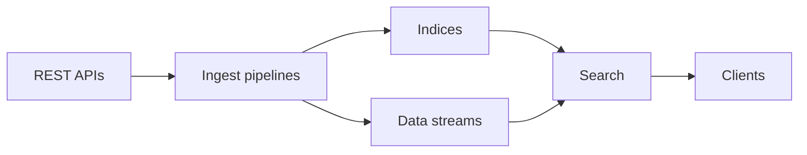

# elastic/elasticsearch

> Distributed search and analysis engine; this README primarily describes how to write and test its documentation.

## The problem
Indexing and querying large volumes of documents, logs, or vectors in near real-time requires a dedicated, distributed engine.

## What it actually does
The provided README does not discuss the product itself, but rather the documentation guide: sources for the documentation, migration from AsciiDoc to Markdown for version 9.0, previews of pull requests, and testing of `console` snippets via `./gradlew -pdocs check`. Based on the architecture, the engine receives documents via REST, indexes or data streams, and searches for them (using ingestion pipelines, vector search, and logs).

## How it is wired


## Trying it
```bash
./gradlew -pdocs check
./gradlew -pdocs yamlRestTest --tests "*rollover*"
```

## Cost and gotchas
The documentation for the tests requires the Gradle build chain; the test snippets are temporarily disabled, as indicated in the README. Installation of the engine is not documented here.

## What it is not
This README is not an installation or usage guide. The license is not included, and GitHub does not identify it.

## Alternatives
No alternative is specified in the README file.

## For you
Things to watch out for: the engine remains central for searching and logging, but this document, due to a lack of product information and an unclear license, does not allow for further conclusions.
