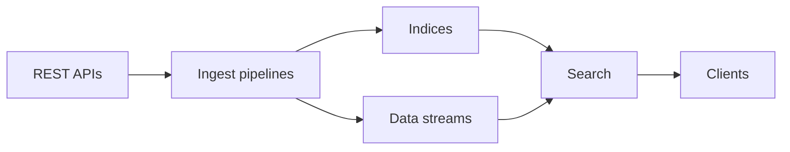

# elastic/elasticsearch

> Moteur de recherche et d'analyse distribué ; ce README décrit surtout comment écrire et tester sa documentation.

## Le problème
Indexer et interroger de gros volumes de documents, de logs ou de vecteurs en quasi temps réel exige un moteur distribué dédié.

## Ce que ça fait vraiment
Le README fourni ne parle pas du produit mais du guide de documentation : sources de la doc, migration d'asciidoc vers Markdown pour la 9.0, aperçus de PR, tests des extraits `console` via `./gradlew -pdocs check`. D'après l'architecture, le moteur reçoit des documents via REST, les range en index ou data streams, et les cherche (ingest pipelines, recherche vectorielle, logs).

## Comment c'est branché


## Essayer
```bash
./gradlew -pdocs check
./gradlew -pdocs yamlRestTest --tests "*rollover*"
```

## Coût et pièges
Les tests de la doc demandent la chaîne de build Gradle ; les extraits de test sont temporairement désactivés selon le README. Installer le moteur n'est pas documenté ici.

## Ce que ce n'est pas
Ce README n'est pas un guide d'installation ni de prise en main. La licence n'y figure pas et GitHub ne l'identifie pas.

## Alternatives
Aucune alternative nommée dans le README.

## Pour toi
À surveiller : le moteur reste central pour la recherche et les logs, mais cette fiche, faute d'information produit et avec une licence à vérifier, ne permet pas de conclure plus.

