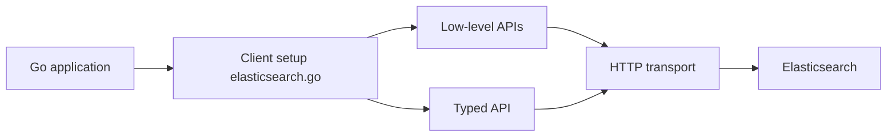

# elastic/go-elasticsearch

> Official Go client for Elasticsearch, with a low-level API, a typed API and bulk indexing helpers.

## The problem
Querying and feeding Elasticsearch from Go without building HTTP requests by hand.

## What it actually does
Provides a configurable client, a low-level API and a typed API with query builders (`esdsl`). The `esutil` package offers `JSONReader` and `BulkIndexer`. Handles interceptors and observability. Several major versions can coexist in the same project.

## How it is wired


## Trying it
```bash
go get github.com/elastic/go-elasticsearch/v9
```
The provided README points to the documentation for installation and connection.

## Cost and gotchas
Free; an Elasticsearch cluster (or Elastic Cloud) is required. Include the major version suffix (`/v8`, `/v9`) in the import.

## What it is not
It is not Elasticsearch nor an ORM: it is a client.

## Alternatives
No alternative named in the README.

## For you
Adopt if you index or search data from Go: official client, maintained by Elastic.
