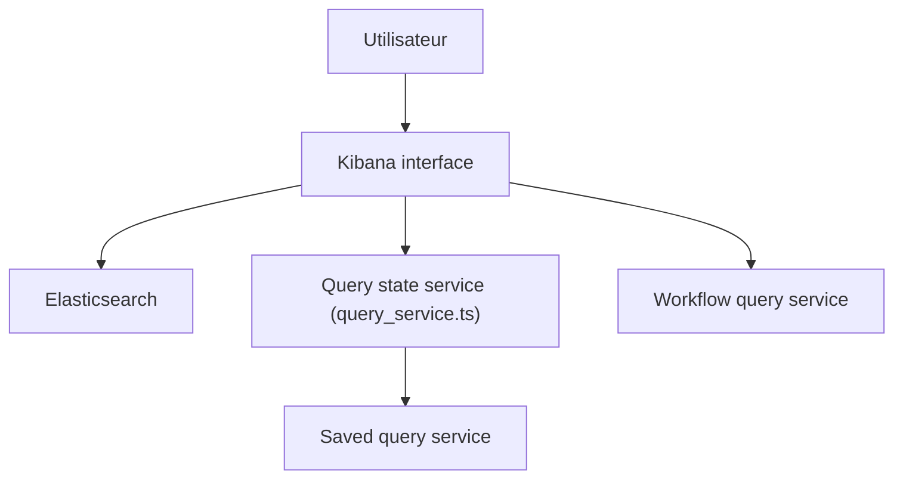

# elastic/kibana

> Web interface to query, analyze, visualize and administer data stored in Elasticsearch.

## The problem
Elasticsearch data is hard to explore and monitor without a dedicated interface.

## What it actually does
Elasticsearch interface: exploration (Discover), saved queries, field preview, APM APIs, management and search of workflow execution logs. The README mostly details version compatibility with Elasticsearch, the same version being recommended.

## How it is wired

## Trying it
No command in the README (it points to the Elastic download page and documentation).

## Cost and gotchas
Requires an Elasticsearch cluster of a compatible version: an older major or a newer minor on the ES side causes a fatal error. Hosted version is paid at Elastic. Over 14,000 open issues.

## What it is not
Not a standalone tool: without Elasticsearch, it is useless. License present but not identified by GitHub.

## Alternatives
No alternative named in the README.

## For you
Watch: the standard for observing logs and metrics of a pipeline already on Elasticsearch, useless otherwise; license to check.
