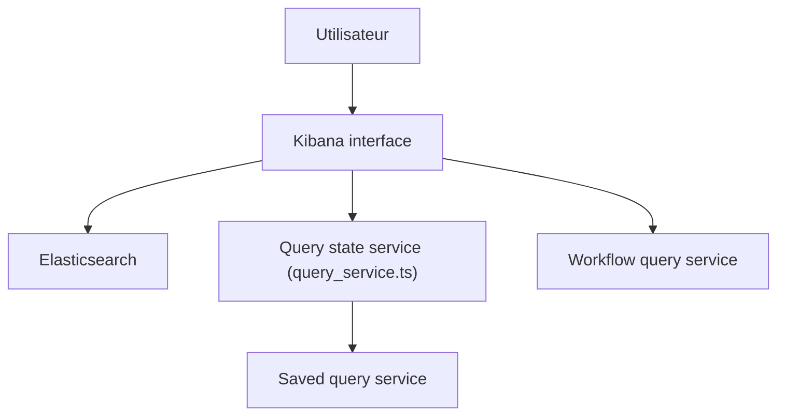

# elastic/kibana

> Interface web pour interroger, analyser, visualiser et administrer les données stockées dans Elasticsearch.

## Le problème
Les données d'Elasticsearch sont difficiles à explorer et à surveiller sans interface dédiée.

## Ce que ça fait vraiment
Interface Elasticsearch : exploration (Discover), requêtes enregistrées, aperçu de champs, APIs APM, gestion et recherche de journaux d'exécution de workflows. Le README détaille surtout la compatibilité de versions avec Elasticsearch, la même version étant recommandée.

## Comment c'est branché

## Essayer
Aucune commande dans le README (renvoie à la page de téléchargement et à la documentation Elastic).

## Coût et pièges
Nécessite un cluster Elasticsearch de version compatible : une majeure plus ancienne ou une mineure plus récente côté ES provoque une erreur fatale. Version hébergée payante chez Elastic. Plus de 14 000 issues ouvertes.

## Ce que ce n'est pas
Pas un outil autonome : sans Elasticsearch, il ne sert à rien. Licence présente mais non identifiée par GitHub.

## Alternatives
Aucune alternative nommée dans le README.

## Pour toi
Surveiller : standard pour observer logs et métriques d'un pipeline déjà sur Elasticsearch, inutile sinon ; licence à vérifier.

