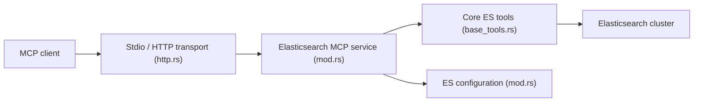

# elastic/mcp-server-elasticsearch

> Rust MCP server, now deprecated, that connects AI agents to Elasticsearch indices.

## The problem
Querying Elasticsearch in natural language from an agent without writing a custom API.

## What it actually does
Exposes five tools through stdio or streamable HTTP: list_indices, get_mappings, search (query DSL), esql and get_shards. Docker image provided by AWS Marketplace, authentication by API key or username and password. A /ping endpoint serves as a health check.

## How it is wired


## Trying it
```bash
docker run -i --rm -e ES_URL -e ES_API_KEY docker.elastic.co/mcp/elasticsearch stdio
```

## Cost and gotchas
Free, but the repository is deprecated and only receives critical security fixes. An Elasticsearch 8.x or 9.x cluster is required. The ES_SSL_SKIP_VERIFY option should be avoided outside tests.

## What it is not
No longer the recommended path: the README says it is replaced by the Elastic Agent Builder MCP endpoint (Elastic 9.2.0+ and Serverless). No writing to indices is announced.

## Alternatives
Elastic Agent Builder MCP endpoint, indicated as the successor in the README.

## For you
Ignore: deprecated by its publisher; use the Agent Builder endpoint if you are on a recent Elastic version.
