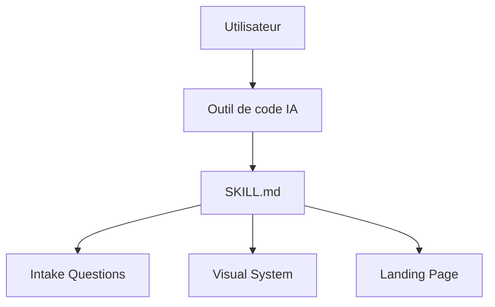

# elayadesign/ai-design-skills

> Collection of Markdown design skills for coding assistants (Claude Code, Cursor, Codex, Windsurf).

## The problem
A coding assistant produces generic landing pages, with no upfront questions and no visual system.

## What it actually does
A single skill for now, `landing-page-design`: intake questions, page structure, conversion copy, visual system (typography, spacing, radius, motion). The design values are gathered in one editable section. The diagram is just the one from the README.

## How it is wired


## Trying it
```bash
mkdir -p .claude/skills
git clone https://github.com/elayadesign/ai-design-skills.git /tmp/ai-design-skills
cp -r /tmp/ai-design-skills/skills/<skill-name> .claude/skills/
```

## Cost and gotchas
Free; consumes context in the tool you use. Recent repository (July 2026).

## What it is not
Not a generator: an instruction file. Only one skill to date.

## Alternatives
Leonxlnx/taste-skill (some of whose ideas are reused).

## For you
Watch: of little use in data/AI, but a clean example of a modular skill to fork.
