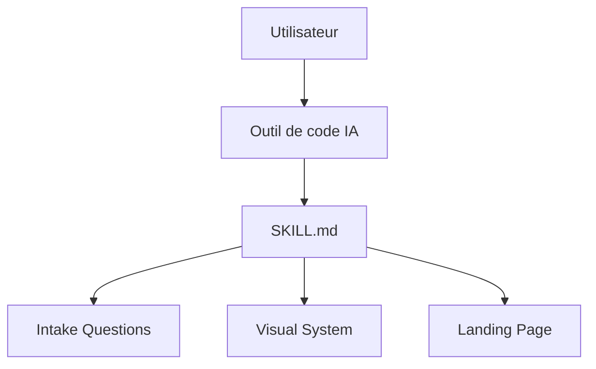

# elayadesign/ai-design-skills

> Collection de skills Markdown de design pour assistants de code (Claude Code, Cursor, Codex, Windsurf).

## Le problème
Un assistant de code produit des landing pages génériques, sans questions préalables ni système visuel.

## Ce que ça fait vraiment
Un seul skill pour l'instant, `landing-page-design` : questions d'intake, structure de page, texte de conversion, système visuel (typo, espacement, rayon, mouvement). Les valeurs de design sont réunies en une section modifiable. Le diagramme n'est que celui du README.

## Comment c'est branché


## Essayer
```bash
mkdir -p .claude/skills
git clone https://github.com/elayadesign/ai-design-skills.git /tmp/ai-design-skills
cp -r /tmp/ai-design-skills/skills/<skill-name> .claude/skills/
```

## Coût et pièges
Gratuit ; consomme du contexte de l'outil utilisé. Dépôt récent (juillet 2026).

## Ce que ce n'est pas
Pas un générateur : un fichier d'instructions. Un seul skill à ce jour.

## Alternatives
Leonxlnx/taste-skill (dont des idées sont reprises).

## Pour toi
Surveiller : peu utile en data/IA, mais exemple propre de skill modulaire à forker.

