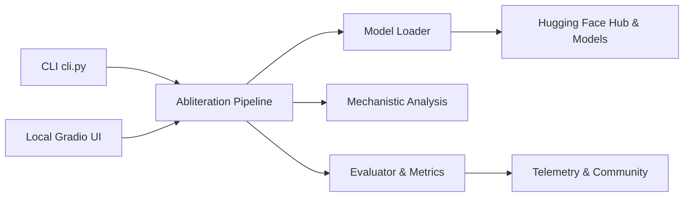

# elder-plinius/OBLITERATUS

> Toolkit that locates and removes the refusal behaviors of LLMs ("abliteration").

## The problem
According to the author, refusals built into models also block research, writing and red-teaming; researchers want to study where these refusals are encoded.

## What it actually does
Six-step pipeline: load the model, collect activations on refused and accepted prompts, extract refusal directions (diff-in-means, SVD, whitened SVD), project them out of the weights, check perplexity and coherence, save. A reversible variant uses steering vectors at inference. On top come 15 analysis modules, ablation studies (layers, heads, FFN) and a Gradio interface.

## How it is wired


## Trying it
```bash
pip install -e .
obliteratus obliterate meta-llama/Llama-3.1-8B-Instruct --method advanced
obliteratus ui
obliteratus gpu-calc meta-llama/Llama-3.1-70B-Instruct --gpu-mem 24
pytest
```

## Cost and gotchas
Free; a GPU is needed beyond small models. Telemetry is enabled by default on the Hugging Face space. AGPL-3.0.

## What it is not
Not a neutral tool: it produces models without safety guardrails, and you alone are responsible for their outputs. The README is very promotional and bills itself as "the most advanced".

## Alternatives
- TransformerLens: real activation patching for interpretability.
- Heretic: abliteration optimized with Optuna.
- RepEng, SAELens: steering vectors and sparse autoencoders.

## For you
Ignore: removing a model's guardrails falls outside enterprise data/MLOps use and creates legal and compliance risk; for interpretability, TransformerLens or SAELens fit better.
