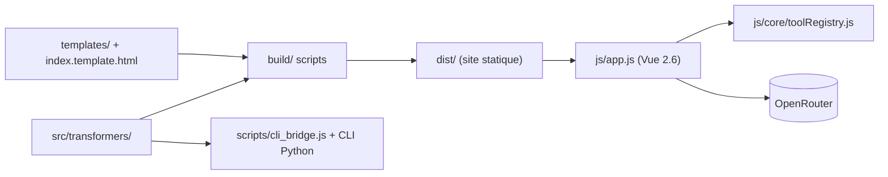

# elder-plinius/P4RS3LT0NGV3

> Static web application for text transformation (222 transformations, steganography) with optional tools via OpenRouter.

## The problem
Encoding, decoding, encrypting or styling text requires chaining many small scattered tools. Here everything is gathered in a single interface.

## What it actually does
Applies 222 transformations (encodings, classical ciphers, Unicode styles, fancy alphabets), decodes automatically by heuristic, hides text in emojis or invisible characters, and offers a tokenizer (GPT BPE). The PromptCraft, Anti-Classifier and Translation tabs call models via OpenRouter with your key.

## How it is wired


## Trying it
```bash
npm install
npm run build
npm start
npm test
uv run p4rs3lt0ngv3-cli encode --transform base64 --text "Hello World"
```

## Cost and gotchas
The core works offline. The AI tools require an OpenRouter account and credits for frontier models; the key is stored in the browser. `dist/` is not versioned: you must build after each clone.

## What it is not
Not a proven security tool: classical ciphers offer no real protection. The "Anti-Classifier" and "PromptCraft" tools are used to rewrite prompts for robustness testing; the README does not detail any evaluation.

## Alternatives
The README cites no alternative.

## For you
Worth watching: useful for testing prompt encodings and tokenization, but AGPL, a single maintainer and a catch-all scope limit serious MLOps use.
