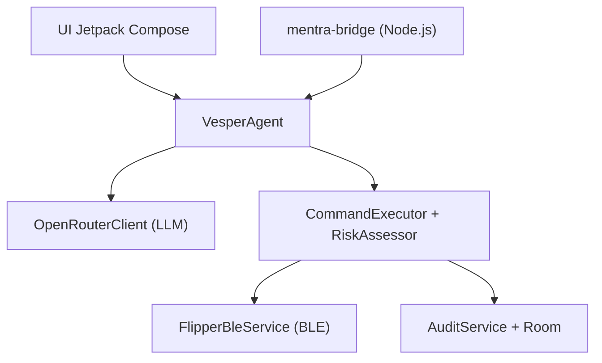

# elder-plinius/V3SP3R

> Android app that drives a Flipper Zero in natural language through an OpenRouter model.

## The problem
Using a Flipper Zero (SubGHz, infrared, NFC, BadUSB) requires knowing its menus, file formats and protocols.

## What it actually does
The Android app (Jetpack Compose) connects to the Flipper over Bluetooth and sends your requests, as text, voice or photo, to a model via OpenRouter. An agent calls tools that read state, manage files, launch apps or generate payloads. Each action is ranked by risk: automatic reading, writing with a diff, destruction with double confirmation, system paths blocked. An audit log keeps the history; a Node.js bridge connects Mentra glasses.

## How it is wired


## Trying it
```bash
git clone https://github.com/elder-plinius/V3SP3R.git
cd V3SP3R
./gradlew assembleDebug
# APK: app/build/outputs/apk/debug/app-debug.apk
```

## Cost and gotchas
OpenRouter key (sk-or-...) with $5 to $10 of credit recommended, Flipper Zero, Android 8.0+, JDK 17+, Bluetooth and location permissions. No APK published: you have to build it.

## What it is not
Not an autonomous security tool: an LLM decides on actions on hardware capable of emitting signals and running HID scripts. The README speaks of legitimate use and refusal of malicious requests, without backing it up. AGPL-3.0 license.

## Alternatives
No alternative mentioned in the README.

## For you
Ignore: it is LLM-driven control of pentest hardware, outside your data / AI / MLOps scope, with a dependency on OpenRouter and an AGPL license.
