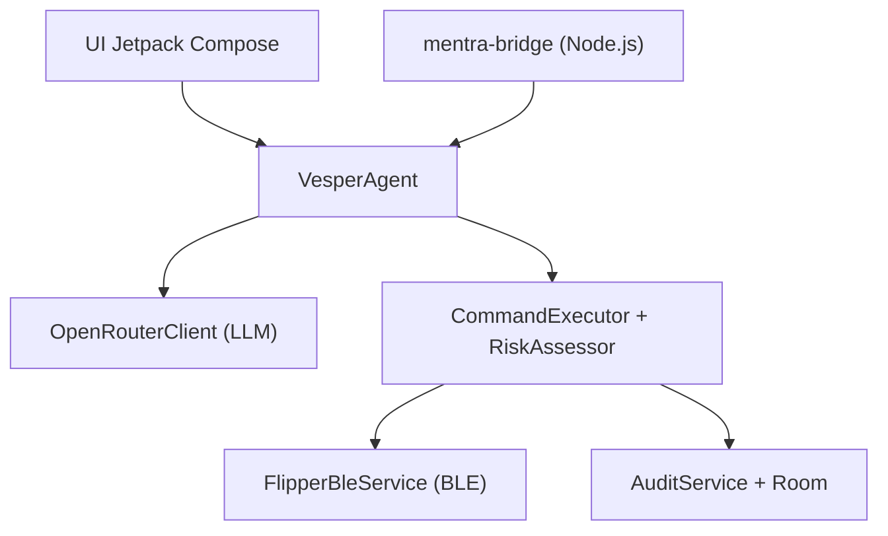

# elder-plinius/V3SP3R

> Application Android qui pilote un Flipper Zero en langage naturel via un modèle OpenRouter.

## Le problème
Utiliser un Flipper Zero (SubGHz, infrarouge, NFC, BadUSB) demande de connaître ses menus, ses formats de fichiers et ses protocoles.

## Ce que ça fait vraiment
L'app Android (Jetpack Compose) relie le Flipper en Bluetooth et envoie tes demandes, en texte, voix ou photo, à un modèle via OpenRouter. Un agent appelle des outils qui lisent l'état, gèrent les fichiers, lancent des apps ou génèrent des payloads. Chaque action est classée par risque : lecture automatique, écriture avec diff, destruction avec double confirmation, chemins système bloqués. Un journal d'audit garde l'historique ; un pont Node.js relie des lunettes Mentra.

## Comment c'est branché


## Essayer
```bash
git clone https://github.com/elder-plinius/V3SP3R.git
cd V3SP3R
./gradlew assembleDebug
# APK: app/build/outputs/apk/debug/app-debug.apk
```

## Coût et pièges
Clé OpenRouter (sk-or-...) avec 5 à 10 $ de crédit conseillés, Flipper Zero, Android 8.0+, JDK 17+, permissions Bluetooth et localisation. Aucun APK publié : il faut compiler.

## Ce que ce n'est pas
Pas un outil de sécurité autonome : un LLM décide d'actions sur du matériel capable d'émettre des signaux et d'exécuter des scripts HID. Le README parle d'usage légitime et de refus des demandes malveillantes, sans l'étayer. Licence AGPL-3.0.

## Alternatives
Aucune alternative citée dans le README.

## Pour toi
À ignorer : c'est du pilotage de matériel de pentest par LLM, hors de ton périmètre data / IA / MLOps, avec dépendance à OpenRouter et licence AGPL.

