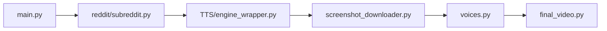

# elebumm/RedditVideoMakerBot

> Python script that turns a Reddit thread into a short video with a synthetic voice.

## The problem
Producing short Reddit-based videos by hand takes editing and asset gathering.

## What it actually does
`main.py` fetches a thread through the Reddit API, synthesizes the voice with a TTS provider (GTTS, AWS Polly, ElevenLabs, pyttsx, TikTok, Streamlabs Polly), captures screenshots with Playwright, then assembles the video with a background and ffmpeg. The README states that it uploads nothing: the file has to be published by hand.

## How it is wired


## Trying it
```bash
git clone https://github.com/elebumm/RedditVideoMakerBot.git
cd RedditVideoMakerBot
python3 -m venv ./venv
source ./venv/bin/activate
pip install -r requirements.txt
python -m playwright install
python -m playwright install-deps
python main.py
```

## Cost and gotchas
You must create a Reddit application of type "script". Some TTS providers (AWS Polly, ElevenLabs) require an account, not detailed in the README. GPL-3.0 license.

## What it is not
Not a publishing or editing tool. Installation through the `curl | bash` script is marked experimental.

## Alternatives
No alternative named in the README.

## For you
Ignore: content automation outside the data/AI/MLOps scope, and GPL-3.0 copyleft to consider if you wanted to integrate it.
