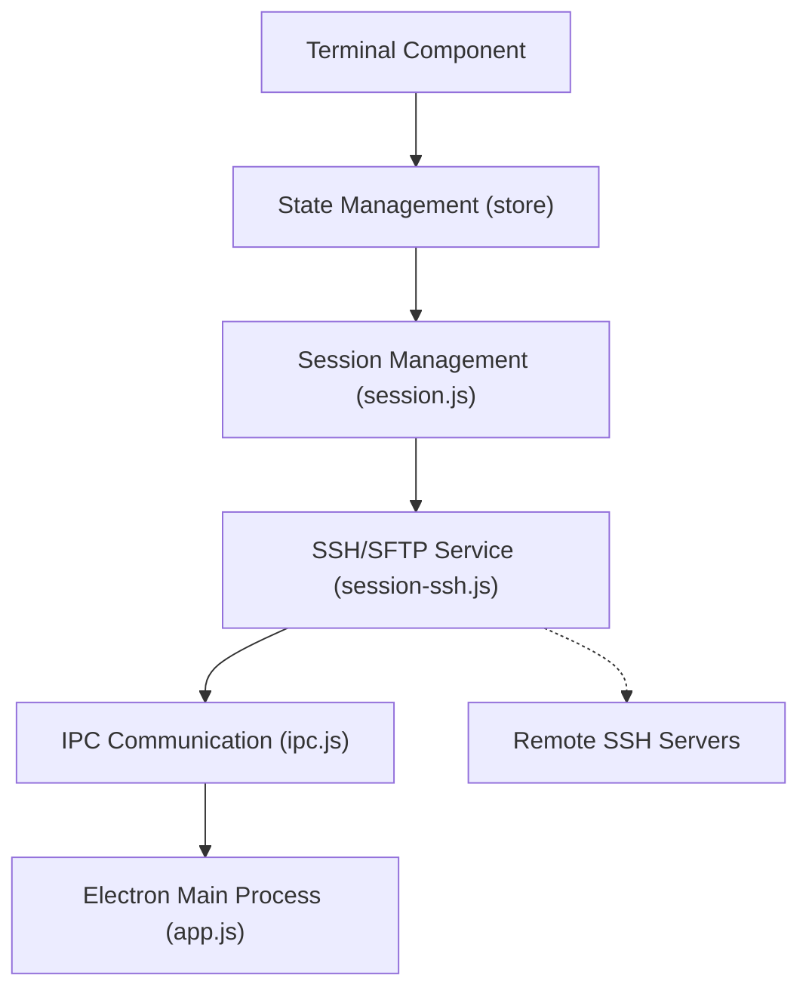

# electerm/electerm

> Open source desktop client for SSH, SFTP, telnet, serial, RDP, VNC and FTP, on many systems.

## The problem
Juggling a terminal, an SFTP client and separate RDP/VNC tools, with bookmarks that are not synchronized.

## What it actually does
A terminal with a remote file manager, SSH tunnels, jump hosts, Zmodem and Trzsz, quick commands, mirrored input across several terminals and bookmark synchronization (GitHub or Gitee gist, WebDAV, custom server). AI assistant compatible with OpenAI and Anthropic, with agent mode, and an MCP widget. Electron application with a main process (SSH, telnet, serial, RDP, VNC sessions) and a front-end interface.

## How it is wired


## Trying it
```bash
brew install --cask electerm
sudo snap install electerm --classic
winget install electerm.electerm
npm i -g electerm
```

## Cost and gotchas
Free. The AI features require an API provider at your own expense. Synchronization sends your bookmarks to a third-party service of your choice.

## What it is not
Not a simple terminal: an Electron application, therefore heavier. A single contact is listed as the author.

## Alternatives
No alternative named in the README.

## For you
Worth watching: handy for administering servers from a single interface, but it depends on one main maintainer; adopt it if the graphical usage suits you.
