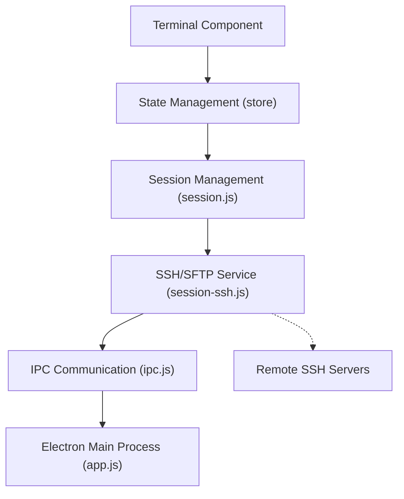

# electerm/electerm

> Client de bureau open source pour SSH, SFTP, telnet, série, RDP, VNC et FTP, sur de nombreux systèmes.

## Le problème
Jongler entre un terminal, un client SFTP et des outils RDP/VNC séparés, avec des signets non synchronisés.

## Ce que ça fait vraiment
Un terminal avec gestionnaire de fichiers distant, tunnels SSH, rebond, Zmodem et Trzsz, commandes rapides, saisie miroir sur plusieurs terminaux et synchronisation des signets (gist GitHub ou Gitee, WebDAV, serveur personnalisé). Assistant IA compatible OpenAI et Anthropic, avec mode agent, et widget MCP. Application Electron avec processus principal (sessions SSH, telnet, série, RDP, VNC) et interface front.

## Comment c'est branché


## Essayer
```bash
brew install --cask electerm
sudo snap install electerm --classic
winget install electerm.electerm
npm i -g electerm
```

## Coût et pièges
Gratuit. Les fonctions IA demandent un fournisseur d'API à ta charge. La synchronisation envoie tes signets vers un service tiers au choix.

## Ce que ce n'est pas
Pas un simple terminal : application Electron, donc plus lourde. Un contact unique est indiqué comme auteur.

## Alternatives
Aucune alternative nommée dans le README.

## Pour toi
À surveiller : pratique pour administrer des serveurs depuis une interface unique, mais dépend d'un mainteneur principal ; adopte si l'usage graphique te convient.

