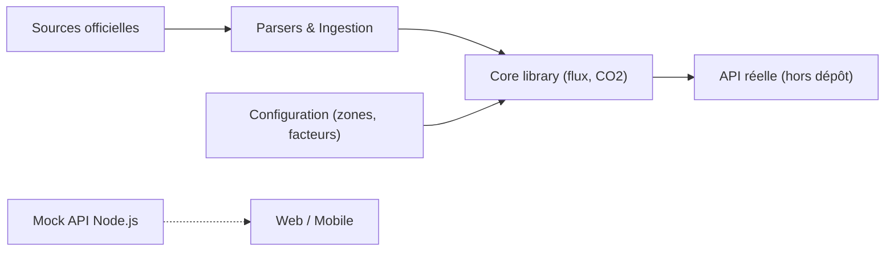

# electricitymaps/electricitymaps-contrib

> A collection of Python parsers that standardize electricity production, exchanges and prices by country.

## The problem
Power grid data is published in disparate formats by each grid operator.

## What it actually does
Python modules that fetch official public data (TSOs, governments) and normalize it. Configuration in YAML/JSON (zones, exchanges, emission factors, capacities). The repo also contains a Node.js mock server and a mobile app; the web map front end was rewritten and removed from the repo.

## How it is wired


## Trying it
```bash
# Aucune commande dans le README ; consulter la documentation liée.
```

## Cost and gotchas
Free; access to the API and historical datasets goes through the company's portal (terms not detailed here).

## What it is not
Not the complete application: the production front end and backend are not in this repo. AGPL-3.0: network copyleft.

## Alternatives
- Electricity Maps data portal: historical datasets already aggregated.

## For you
Worth watching: a useful source of carbon intensity data for data/energy projects, but the full service remains proprietary.
