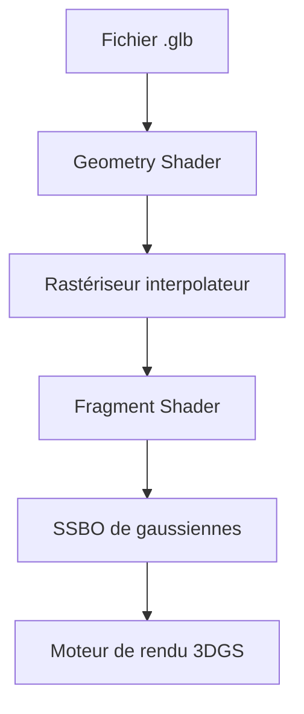

# electronicarts/mesh2splat

> Converts a 3D mesh into a Gaussian Splatting model in milliseconds, with a rendering engine.

## The problem
Getting a 3DGS representation of a synthetic model goes through a set of images and an optimization lasting several minutes.

## What it actually does
Reads a `.glb` and, instead of optimizing, computes the Gaussians directly from the geometry and textures (diffuse, metal-roughness, normals), via the rasterizer: triplanar projection, Jacobian, one Gaussian per vertex. The README claims less than 0.5 ms on average. A 3DGS rendering engine (albedo, normals, depth, PBR, shadows) is included.

## How it is wired

Simplified diagram based on the sheet, no diagram provided.

## Trying it
```bash
mkdir build && cd build
cmake ..
cmake --build . -j16
```

## Cost and gotchas
Free. Requires an OpenGL-compatible GPU; Linux packages to install (GLFW, GLEW, FreeImage). License not identified by GitHub. Only the `.glb` format is supported.

## What it is not
Not a reconstruction tool from photos. Vegetation, hair and clouds are out of scope.

## Alternatives
No alternative named in the README.

## For you
Watch: useful to bootstrap a 3DGS pipeline from synthetic assets, but experimental and not very MLOps-oriented.
