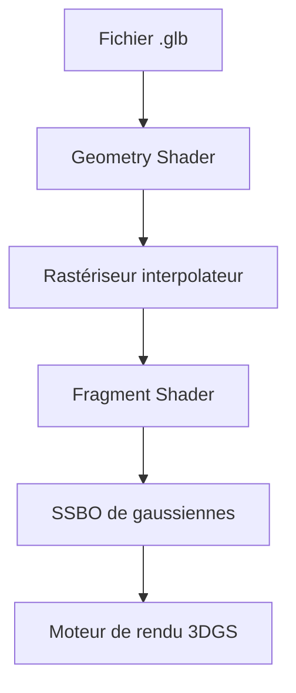

# electronicarts/mesh2splat

> Convertit un maillage 3D en modèle de Gaussian Splatting en millisecondes, avec un moteur de rendu.

## Le problème
Obtenir une représentation 3DGS d'un modèle synthétique passe par un jeu d'images et une optimisation de plusieurs minutes.

## Ce que ça fait vraiment
Lit un `.glb` et, au lieu d'optimiser, calcule directement les gaussiennes depuis la géométrie et les textures (diffuse, métal-rugosité, normales), via le rastériseur : projection triplanaire, jacobienne, une gaussienne par sommet. Le README annonce moins de 0,5 ms en moyenne. Un moteur de rendu 3DGS (albedo, normales, profondeur, PBR, ombres) est inclus.

## Comment c'est branché

Schéma simplifié d'après la fiche, sans diagramme fourni.

## Essayer
```bash
mkdir build && cd build
cmake ..
cmake --build . -j16
```

## Coût et pièges
Gratuit. Exige un GPU compatible OpenGL ; paquets Linux à installer (GLFW, GLEW, FreeImage). Licence non identifiée par GitHub. Seul le format `.glb` est géré.

## Ce que ce n'est pas
Pas un outil de reconstruction depuis des photos. Végétation, cheveux et nuages sont hors cible.

## Alternatives
Aucune alternative nommée dans le README.

## Pour toi
Surveiller : utile pour initialiser un pipeline 3DGS à partir d'actifs synthétiques, mais expérimental et peu orienté MLOps.

