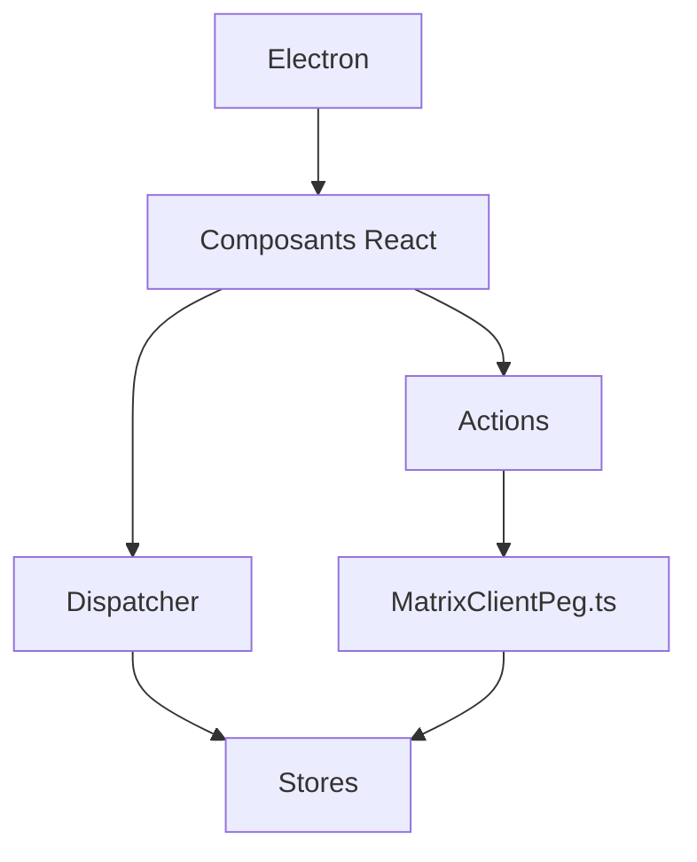

# element-hq/element-web

> Web and desktop client for the Matrix protocol, for anyone who wants encrypted, self-hostable messaging.

## The problem
Centralized messaging apps lock in conversations; Matrix lets you choose your server, and you need a client.

## What it actually does
A Matrix client in React and TypeScript, built on the Matrix JavaScript SDK. It runs in the browser, or as a desktop application via Electron. The repository is a monorepo. The described architecture shows a Flux-style model (dispatcher, stores, actions) and a server connection through `MatrixClientPeg.ts`.

## How it is wired

## Trying it
No command documented in the README: it points to the installation page and the development guide.

## Cost and gotchas
Free, AGPL-3.0 license (strong copyleft for a modified service). You need a Matrix server, public or self-hosted, to chat. The `develop` branch is continuously deployed and may be unstable.

## What it is not
Not a Matrix server: it is the client. Not an AI tool, just a messaging app.

## Alternatives
- No alternative named in the README.

## For you
Watch: interesting if your team wants self-hosted internal messaging; the AGPL requires some thought if you modify the code.
