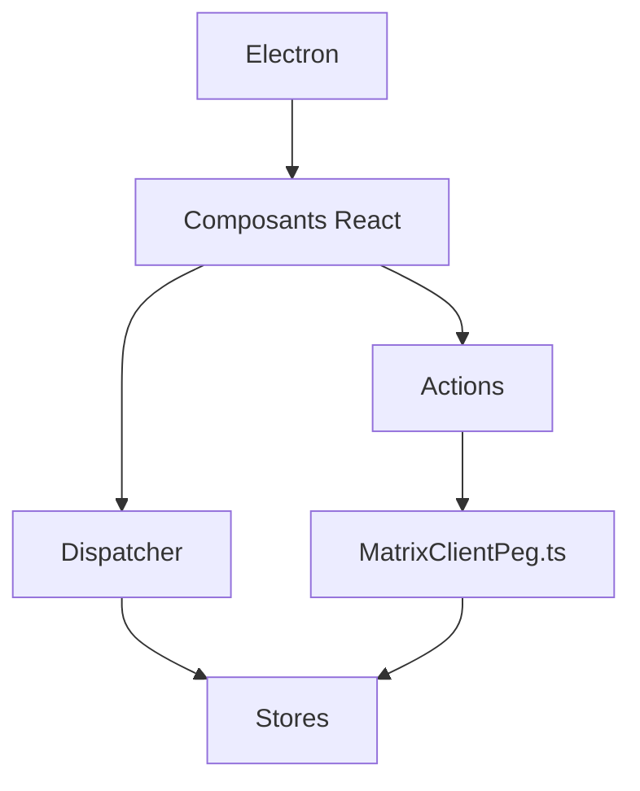

# element-hq/element-web

> Client web et bureau pour le protocole Matrix, pour qui veut une messagerie chiffrée et auto-hébergeable.

## Le problème
Les messageries centralisées enferment les conversations ; Matrix permet de choisir son serveur, et il faut un client.

## Ce que ça fait vraiment
Client Matrix en React et TypeScript, bâti sur le SDK JavaScript Matrix. Il s'exécute dans le navigateur, ou en application de bureau via Electron. Le dépôt est un monorepo. L'architecture décrite montre un modèle de type Flux (dispatcher, stores, actions) et une connexion au serveur via `MatrixClientPeg.ts`.

## Comment c'est branché

## Essayer
Aucune commande documentée dans le README : il renvoie à la page d'installation et au guide de développement.

## Coût et pièges
Gratuit, licence AGPL-3.0 (copyleft fort pour un service modifié). Il faut un serveur Matrix, public ou auto-hébergé, pour discuter. La branche `develop` est déployée en continu et peut être instable.

## Ce que ce n'est pas
Pas un serveur Matrix : c'est le client. Pas un outil d'IA, juste une messagerie.

## Alternatives
- Aucune alternative nommée dans le README.

## Pour toi
À surveiller : intéressant si ton équipe veut une messagerie interne auto-hébergée ; l'AGPL impose une réflexion si tu modifies le code.

