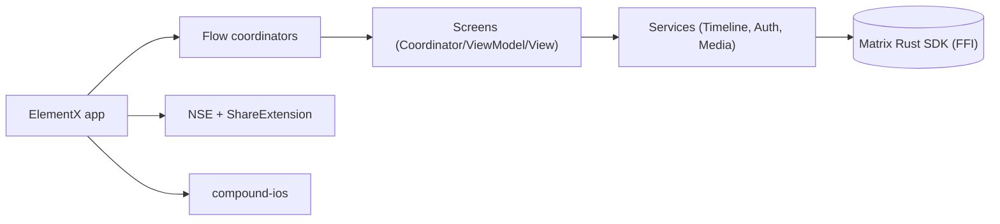

# element-hq/element-x-ios

> Element's next-generation Matrix iOS client, rewritten on the Rust SDK, for iOS 18+ users.

## The problem
A native Matrix messaging client is needed, one that shares its protocol logic with the other platforms instead of rewriting it.

## What it actually does
A SwiftUI app organized into coordinators, view models and screens, which delegates the Matrix protocol to the Matrix Rust SDK through a Swift FFI package. It covers authentication (OAuth, QR), rooms, spaces, timeline, notifications (NSE extension), sharing, locking and voice messages. The Compound design system is a separate package.

## How it is wired

## Trying it
The README gives no command: it points to the contributing guide (development environment) and to the fork guide.

## Cost and gotchas
Built with Xcode/XcodeGen; iOS 18+ required. A Matrix account (homeserver) is needed. 400 open issues.

## What it is not
It is not the legacy Element Classic client, nor a Matrix server. The README is brief: many details are in the contributing guide.

## Alternatives
- Element Classic: previous-generation client, which the README discourages for new users.

## For you
Ignore: an iOS messaging application, useful for reading an example of Swift/Rust architecture, unrelated to data/AI/MLOps work.
