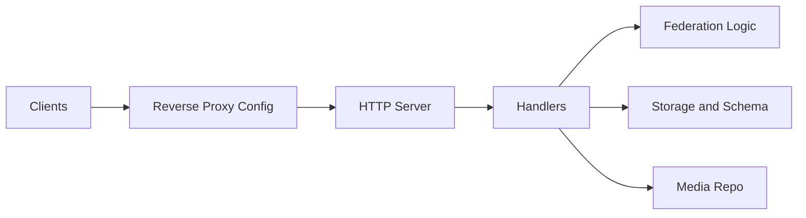

# element-hq/synapse

> Matrix homeserver in Python, maintained by Element, for federated and secure messaging.

## The problem
Hosting your own interoperable real-time messaging, rather than depending on an operator.

## What it actually does
A Python server (with some Rust) exposes the client and federation APIs, handles rooms, events, media and encryption, and stores data in PostgreSQL or SQLite. Separate workers absorb the load. The README points to Element Server Suite for the official deployment.

## How it is wired

## Trying it
No command in the provided README: it refers to the installation documentation.

## Cost and gotchas
Dual license: free AGPL or an Element commercial license. Support only with an ESS subscription. 2,084 open issues.

## What it is not
Not a turnkey tool: ESS Community, Pro and TI-M are the official editions. Support is not provided through GitHub.

## Alternatives
No alternative named in the README.

## For you
Ignore for data/AI work: it is messaging infrastructure, to be chosen only if you need to host Matrix.
