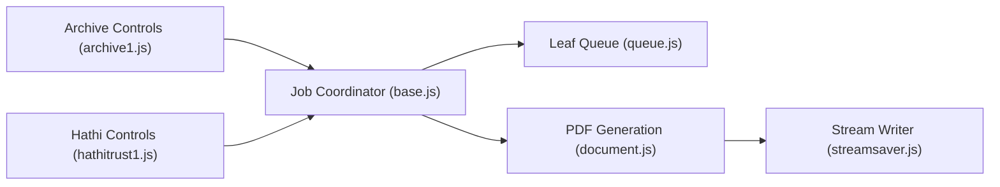

# elementdavv/internet_archive_downloader

> Browser extension that downloads borrowed Internet Archive books as PDF or images.

## The problem
Borrowed books can only be read online, for a limited time.

## What it actually does
- Fetches each page, builds a PDF streamed directly to disk (low memory).
- PDF output with embedded text, or JPEG/PNG images per page, plus text.
- Also handles HathiTrust (full access), page range, parallel downloads.
- Chromium 90 minimum, Firefox 115 minimum.

## How it is wired

## Trying it
No command documented: download the .crx or .xpi from Releases, or install from the Edge and Firefox stores.

## Cost and gotchas
Free. The README states that downloading borrowed books is prohibited and asks that they be deleted within 48 h: legal risk is on you.

## What it is not
Not a collection tool for datasets; use "for study purposes" according to the author.

## Alternatives
No alternative named in the README.

## For you
Ignore: circumvents borrowing restrictions, unrelated to your work and legally risky.
