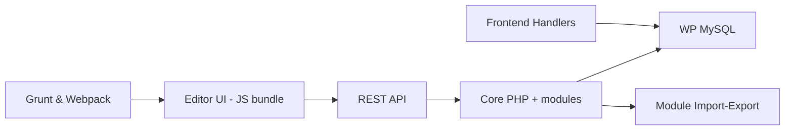

# elementor/elementor

> Drag-and-drop website builder, a WordPress plugin, for web designers and marketers.

## The problem
Building polished WordPress pages requires code or rigid themes.

## What it actually does
PHP plugin + JavaScript editor (Backbone/Marionette): the editor calls `wp-json/elementor/v2` REST endpoints, PHP controllers write to WordPress's MySQL database; on the public side, JS handlers animate the widgets. The modules (import-export, kit library, onboarding, site-editor, AI) are self-contained. Built with Grunt + Webpack.

## How it is wired


## Trying it
The README gives no command: installation goes through WordPress (not documented here).

```bash
# aucune commande dans le README
```

## Cost and gotchas
The README mentions "Elementor One" (a commercial offering); the free scope is not detailed there. Requires a WordPress. 3,964 open issues.

## What it is not
Not a data/AI tool; the README touts "the most advanced" without proving it.

## Alternatives
No alternative named in the README.

## For you
Ignore: a WordPress site-building tool with no link to data, AI or MLOps.
