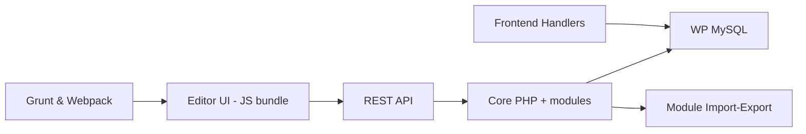

# elementor/elementor

> Constructeur de sites par glisser-déposer, plugin WordPress, pour webdesigners et marketeurs.

## Le problème
Créer des pages WordPress soignées demande du code ou des thèmes rigides.

## Ce que ça fait vraiment
Plugin PHP + éditeur JavaScript (Backbone/Marionette) : l'éditeur appelle des endpoints REST `wp-json/elementor/v2`, les contrôleurs PHP écrivent en base MySQL de WordPress ; côté public, des handlers JS animent les widgets. Les modules (import-export, kit library, onboarding, site-editor, IA) sont autonomes. Compilation Grunt + Webpack.

## Comment c'est branché


## Essayer
Le README ne donne aucune commande : installation via WordPress (non documentée ici).

```bash
# aucune commande dans le README
```

## Coût et pièges
Le README évoque « Elementor One » (offre commerciale) ; le périmètre gratuit n'y est pas détaillé. Nécessite un WordPress. 3 964 issues ouvertes.

## Ce que ce n'est pas
Ce n'est pas un outil data/IA ; le README vante « le plus avancé » sans le prouver.

## Alternatives
Aucune alternative nommée dans le README.

## Pour toi
À ignorer : outil de création de sites WordPress sans lien avec data, IA ou MLOps.

