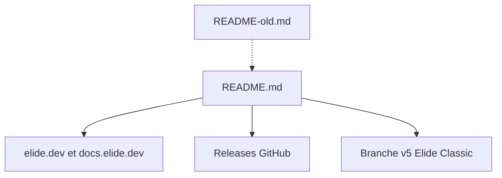

# elide-dev/elide

> A single runtime and toolchain for Kotlin, JavaScript, TypeScript and Python.

## The problem
Juggling several runtimes and build toolchains depending on the language.

## What it actually does
The README announces a common runtime for four languages. The repository now contains only the README and an old version: the code is no longer public (source-available license). The rest is not documented here.

## How it is wired


## Trying it
```bash
# Aucune commande documentée dans le README : voir elide.dev et les releases.
```

## Cost and gotchas
Free to use according to the README, but source-available license: contributions via Discord. Nothing to audit in the repository.

## What it is not
It is not an open, open-source project: the current code cannot be read here. Only the old code lives on the v5 branch.

## Alternatives
None named in the README.

## For you
Ignore: closed code, too little material to judge, and no demonstrated gain for a data / AI profile.
