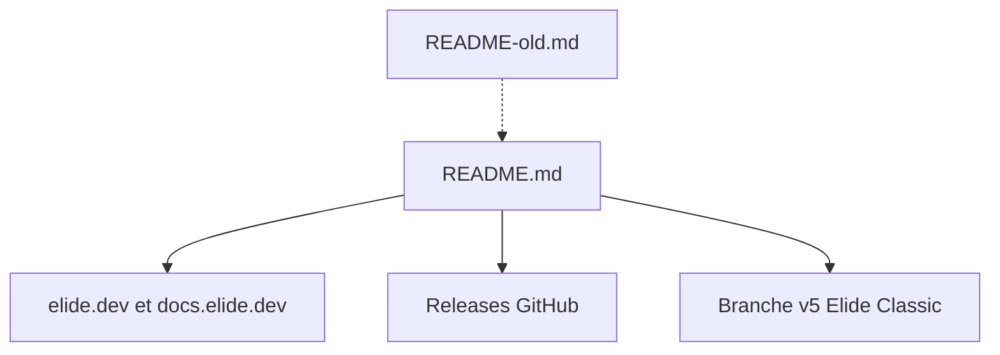

# elide-dev/elide

> Runtime et chaîne d'outils uniques pour Kotlin, JavaScript, TypeScript et Python.

## Le problème
Jongler entre plusieurs runtimes et chaînes de build selon le langage.

## Ce que ça fait vraiment
Le README annonce un runtime commun pour quatre langages. Le dépôt ne contient plus que le README et une ancienne version : le code n'est plus public (licence source-available). Le reste est non documenté ici.

## Comment c'est branché


## Essayer
```bash
# Aucune commande documentée dans le README : voir elide.dev et les releases.
```

## Coût et pièges
Gratuit à l'usage d'après le README, mais licence source-available : contribution via Discord. Rien à auditer dans le dépôt.

## Ce que ce n'est pas
Ce n'est pas un projet open source ouvert : le code actuel n'est pas lisible ici. Seul l'ancien code vit sur la branche v5.

## Alternatives
Aucune nommée dans le README.

## Pour toi
À ignorer : code fermé, matière trop mince pour juger, et pas de gain démontré pour un profil data / IA.

