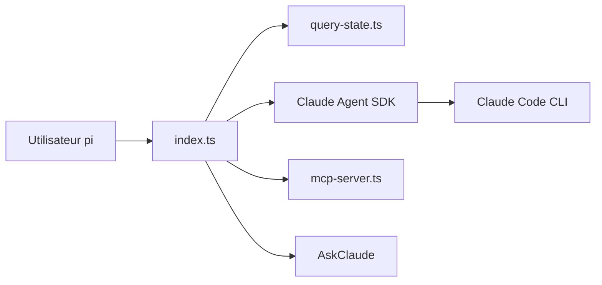

# elidickinson/pi-claude-bridge

> Extension for the pi agentic editor: uses Claude Code as a model provider and delegation tool.

## The problem
Using Claude models in pi through an existing subscription, with pi's tools, is not straightforward.

## What it actually does
Two features: a provider that exposes Claude models (1M context depending on the plan) with tool calls going through pi's interface, and an opt-in AskClaude tool to delegate to Claude Code (modes read, none, full; isolated or not). Built on the Claude Agent SDK; forwards skills; rebuilds the Claude session from pi's history.

## How it is wired


## Trying it
```bash
pi install npm:pi-claude-bridge
```

## Cost and gotchas
Consumes your Claude subscription quota; the README flags uncertainty about Agent SDK billing. A session rebuild resends the whole history (cache miss). Exported ANTHROPIC_* variables break it.

## What it is not
Not standalone: requires pi 0.86.1+ and Claude Code. Does not read global CLAUDE.md files during delegations.

## Alternatives
No alternative cited in the README.

## For you
Worth watching: only if you already use pi and a Claude subscription; otherwise no interest.
