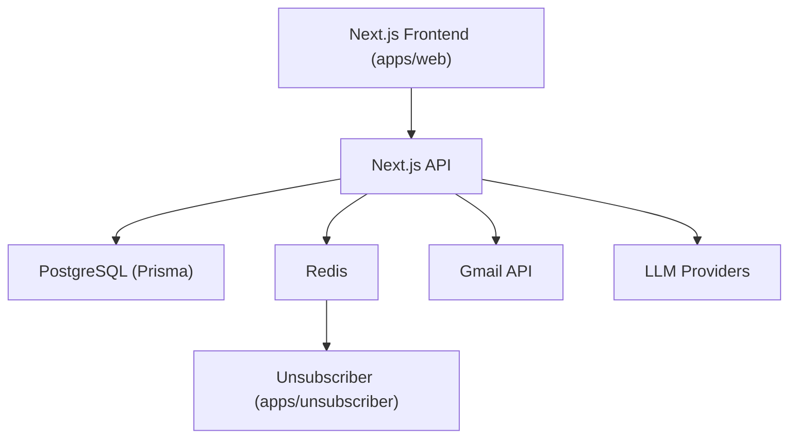

# elie222/inbox-zero

> Open-source AI email assistant and email client for Gmail and Outlook, self-hostable.

## The problem
Sorting the inbox, following up, unsubscribing and preparing meetings eats time every day.

## What it actually does
An AI assistant organizes the inbox, pre-drafts replies in your style, applies rules written in natural language, tracks replies to send or awaited, bulk unsubscribes and archives, blocks cold outreach, summarizes meetings and files attachments into Google Drive or OneDrive. Can be driven from Slack or Telegram. A web and desktop email client comes with it.

## How it is wired


## Trying it
```bash
npx @inbox-zero/cli setup
npx @inbox-zero/cli start
pnpm install
pnpm local:start
```

## Cost and gotchas
Self-hosting: Docker and Node v24+, with OAuth credentials and an LLM provider key (billed to you). Hosted version is separate. The `pnpm local:start` mode only uses simulated AI responses.

## What it is not
Not a service without access to your inbox: it reads your emails and calendar. The native iOS app is not open source. A license is present but not identified by GitHub.

## Alternatives
Fyxer (a hosted alternative of which it presents itself as the open version) and Superhuman for the email client; the README names them without a repository link.

## For you
Worth watching: a concrete example of an agent wired to an LLM, but it asks for full access to your mailbox and its license needs checking.
