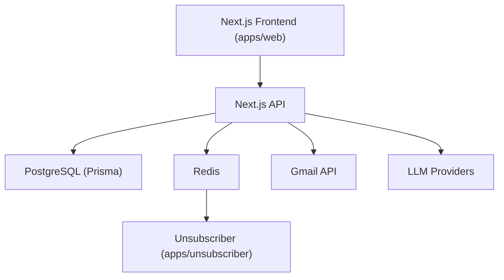

# elie222/inbox-zero

> Assistant e-mail IA et client e-mail open source pour Gmail et Outlook, auto-hébergeable.

## Le problème
Trier la boîte de réception, relancer, se désabonner et préparer ses réunions consomme du temps chaque jour.

## Ce que ça fait vraiment
Un assistant IA organise la boîte, pré-rédige des réponses dans ton style, applique des règles écrites en langage naturel, suit les réponses à envoyer ou attendues, désabonne et archive en masse, bloque le démarchage, résume les réunions et classe les pièces jointes dans Google Drive ou OneDrive. Pilotable depuis Slack ou Telegram. Un client e-mail web et bureau accompagne l'ensemble.

## Comment c'est branché


## Essayer
```bash
npx @inbox-zero/cli setup
npx @inbox-zero/cli start
pnpm install
pnpm local:start
```

## Coût et pièges
Auto-hébergement : Docker et Node v24+, avec identifiants OAuth et clé d'un fournisseur de LLM (facturé à ta charge). Version hébergée à part. Le mode `pnpm local:start` n'utilise que des réponses IA simulées.

## Ce que ce n'est pas
Pas un service sans accès à ta boîte : il lit tes e-mails et ton calendrier. L'application iOS native n'est pas open source. Licence présente mais non identifiée par GitHub.

## Alternatives
Fyxer (alternative hébergée dont il se présente comme version ouverte) et Superhuman pour le client e-mail ; le README les nomme sans lien de dépôt.

## Pour toi
À surveiller : exemple concret d'agent branché sur un LLM, mais il demande l'accès complet à ta messagerie et sa licence est à vérifier.

